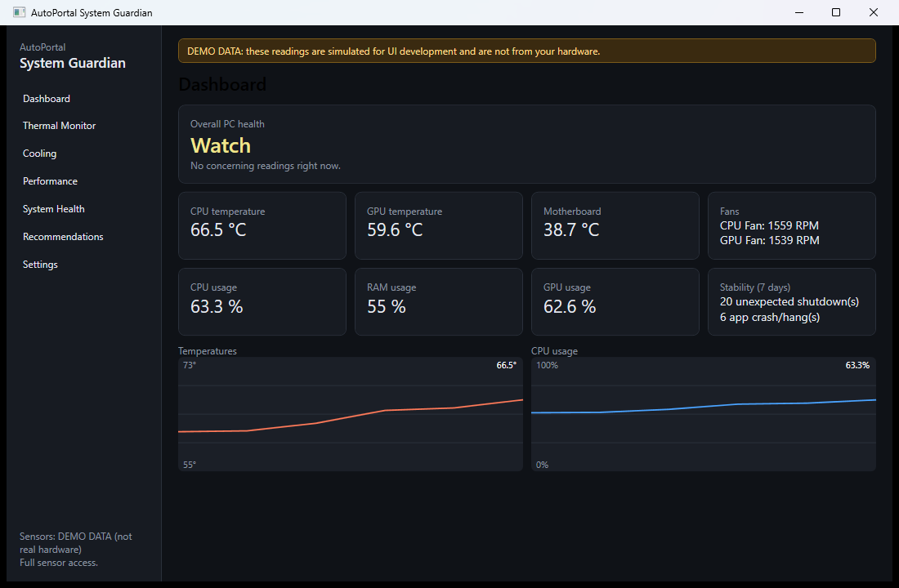

# AutoPortal System Guardian

An open-source Windows tray application that **monitors hardware temperatures, fans and system load, diagnoses likely causes of overheating and freezes, and keeps a local record that survives a power cut**, so that after a freeze you can see what the PC was doing beforehand.

> Status: **0.1.1 (early release)**. See [Known limitations](#known-limitations) before relying on it.


*Demo mode (`--demo`): simulated readings, clearly bannered in the app. The "Stability" tile always shows real Windows event counts from the PC it runs on.*

This repository holds two **independent** modules; install either or both:

| Module | What it does |
|---|---|
| **System Guardian** | Hardware monitoring, thermal diagnosis, freeze investigation (below). |
| **Connectivity Manager** | Detects a captive login portal (e.g. a Fortinet FortiGate) and logs in automatically with *your own* saved credentials. See [Connectivity Manager](#connectivity-manager). |

## What System Guardian does
- Reads CPU / GPU / motherboard / disk temperatures, fan RPM, clocks and power through [LibreHardwareMonitor](https://github.com/LibreHardwareMonitor/LibreHardwareMonitor). **Sensors your hardware doesn't expose show "Not available"; values are never invented.**
- Rule-based thermal diagnosis with configurable Elevated / High / Critical limits per component, plus spike, sustained-heat, idle-hot, throttling-indicator and fan checks.
- Recommendations are labeled as *possibilities* and list the recorded evidence behind them.
- Reads Windows Event Log sources: Kernel-Power 41, unexpected shutdowns (6008), WHEA, bugchecks, display-driver resets, disk errors, app crashes/hangs, TCP/IP port exhaustion, service timeouts.
- Saves samples to a local SQLite database every few seconds (WAL mode). If the previous session ended without a clean exit, the next start tells you when the last sample was recorded. It does **not** claim data from during the freeze itself.
- Watches for processes with abnormal handle counts and for socket exhaustion, common causes of slow degradation followed by hangs.
- Starts at logon through Task Scheduler (normal rights, optional delay, restart-on-failure) and runs quietly in the tray.
- Exports a Markdown diagnostic report. Nothing is uploaded. No telemetry.

## What it deliberately does *not* do
It never disables thermal protection, never turns fans off, never overclocks/undervolts, never writes to undocumented hardware registers, never reboots Windows, never kills processes on its own (critical Windows processes are marked "do not end"), and never resets a network adapter without explicit approval. Changing fan speed needs explicit confirmation and a "restore defaults" action exists.

## Install
1. Download `AutoPortal-System-Guardian-Setup-x.y.z.exe` and/or `AutoPortal-Connectivity-Manager-Setup-x.y.z.exe` (or the portable `.zip`s) from [Releases](../../releases).
2. Verify the SHA-256 in `SHA256SUMS.txt`: `Get-FileHash .\<file>`.
3. Run it. No Python, Git or .NET install is needed (self-contained).
4. For full CPU/motherboard sensors, use **Settings → Restart as administrator**. Without it, those sensors show "Not available".

**Uninstall:** Settings → Apps → AutoPortal System Guardian → Uninstall. The uninstaller removes the startup task. Your history in `%LOCALAPPDATA%\AutoPortal\SystemGuardian` is kept unless you delete it (Settings → Delete diagnostic history).

## Connectivity Manager
Runs in the tray (~50 MB). Every 30 s it requests a known test URL; if the response is a redirect to a login page instead of the expected text, it fills in the portal's username/password form and submits it, then re-checks that the internet works.

1. Open **Settings**, enter the portal **host** (e.g. `192.168.1.1` or `fw.example.com`), your username and password, tick *Log in automatically*.
2. FortiGate portals often use a self-signed certificate: tick *Trust this portal's certificate* (applies to that one host only).
3. Tick *Start with Windows*.

**Security:** the password is stored in **Windows Credential Manager** (encrypted for your Windows account), never in the settings file or logs. Credentials are sent **only** to the configured host, over HTTPS (plain HTTP must be enabled explicitly), and never to a host the portal redirects to. After 3 failed logins in a row it pauses for 30 minutes so a wrong password can't lock your account.

**Limits:** it handles a plain username + password form (including FortiGate's hidden `magic` field). It does **not** handle captchas, OTP/2FA, SSO or "I agree" steps. **It has only been tested against a fake local portal that imitates a FortiGate page, not against a real FortiGate.** If your portal differs, open an issue with the (sanitised) form HTML.

## Build from source
```powershell
dotnet test
dotnet run --project src/ui -- --demo     # simulated data, clearly bannered
./scripts/build.ps1 -Version 0.1.1        # tests, both modules (exe + zip), installers if Inno Setup is installed, checksums, verification
```
The test suite also checks the build script, installer scripts, workflows and the artifact verifier, so a broken pipeline fails CI.

## Repository layout
`src/core` models/settings/SQLite · `src/hardware` sensor providers & fan control · `src/analysis` thermal, cooling, recommendations, reports · `src/windows` event log, Task Scheduler, process monitor, recovery · `src/ui` WPF app · `tests/` · `docs/` · `scripts/` · `installer/`

## Known limitations
- **Compatibility is the hard part.** Sensor and fan availability varies by board. Fan *control* works only where LibreHardwareMonitor supports the Super I/O chip; many OEM boards (e.g. HP/Dell prebuilts) expose none. Monitoring still works.
- **Only tested so far on one Windows 11 machine.** The matrix in the spec (Intel/AMD CPUs, NVIDIA/AMD/Intel GPUs, Windows 10) is *not yet tested*. Reports from other hardware are welcome.
- Memory use is ~180 MB (WPF + sensor library), heavier than ideal for a tray tool.
- Drive health shows Windows' own health status; SMART failure prediction needs administrator rights and driver support, and it applies system-wide, not per drive.
- Liquid-cooler pump detection only appears where the cooler reports a sensor.
- Only the dashboard screenshot exists (demo mode); no code-signing certificate, so Windows SmartScreen will warn on first run.
- Fan-curve *editing* is not implemented: the example curve is shown and validated, and fixed fan speeds can be set where hardware allows, but curves aren't applied automatically yet.
- Connectivity Manager: see its limits above.

License: MIT. Third-party: see [THIRD-PARTY-NOTICES.md](THIRD-PARTY-NOTICES.md).

